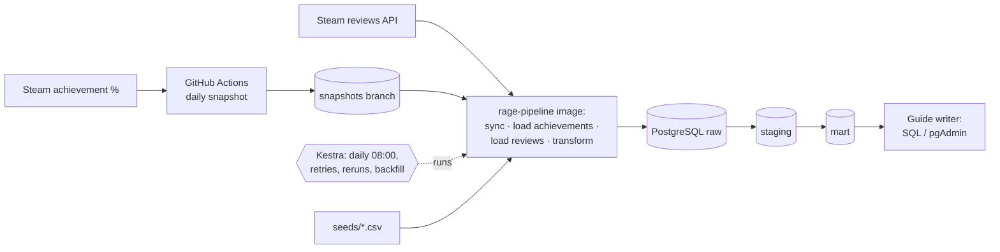

# Elden Ring Boss Rage-Quit Index

> DENG HS26 — End-to-End Batch Data Pipeline · Team XX · Status: **Milestone 2 (midterm, Architecture v0.2)**

Which Elden Ring boss makes players give up? This project combines two public Steam sources:

- **What players do:** the global achievement unlock rate for each boss
- **What players say:** Steam reviews that mention a boss

Together they give each boss a *Rage-Quit Index*.

## Use case

| | |
|---|---|
| **Stakeholder** | An Elden Ring guide writer or YouTuber who has to decide which boss guide to make next |
| **Questions** | 1. At which boss do the most players stop progressing? <br> 2. Which bosses show up more often in *negative* reviews? <br> 3. How many hours into the game does that happen? |
| **Data product** | One ranked table, `boss_rage_ranking` (one row per boss), built from two daily intermediate tables (see [docs/use-case.md](docs/use-case.md)) |

## Data sources

| Source | What | Access | Load pattern |
|---|---|---|---|
| Steam reviews API | ~832k user reviews: text, thumbs up/down, playtime at review | public JSON, no key, cursor pagination | historical backfill, then daily incremental |
| Steam global achievement % | unlock rate for 42 achievements, 30 of them boss kills | public JSON, no key | daily snapshot (the API only returns the current value) |

Plus two small hand-made seed tables in `seeds/`, versioned in git:
- `achievement_boss_map.csv`: achievement code → boss
- `boss_aliases.csv`: boss → the names players use in reviews

Details (schema, volume, quality risks): [docs/dataset.md](docs/dataset.md)

## Architecture v0.2



Everything except the GitHub Actions snapshot runs locally in Docker Compose on the network `rage-net`: PostgreSQL, pgAdmin, Kestra and the pipeline image. For the final milestone, the raw landing moves to **Google Cloud Storage** and the curated layer to **BigQuery**, both provisioned with Terraform.

- Full description, the grain of every table, failure handling, and changes since v0.1: [docs/architecture-v0.2.md](docs/architecture-v0.2.md)
- Pitch version: [docs/architecture-v0.1.md](docs/architecture-v0.1.md)
- Why these sources: [docs/adr/0001-data-source-selection.md](docs/adr/0001-data-source-selection.md)

## Repository structure

```
.
├── docs/                 # dataset, use case, architecture, plan, ADRs
├── seeds/                # hand-maintained mapping tables
├── ingestion/            # one module per source + snapshot sync
├── sql/                  # init/ schemas, staging/ and transform/ SQL
├── transform/            # runs seeds + sql/transform/ in one transaction
├── orchestration/flows/  # Kestra flow (daily pipeline)
├── infra/terraform/      # GCS bucket + BigQuery dataset      (Milestone 3)
├── pgadmin/              # pgAdmin server registration
├── Dockerfile            # pipeline image (ingestion + transform)
├── docker-compose.yml    # PostgreSQL + pgAdmin + Kestra + pipeline on network rage-net
├── .github/workflows/    # daily achievement snapshot
├── data/                 # local data, never committed
└── .env.example          # environment variables (no real secrets)
```

## Milestones

| Milestone | Date | Status |
|---|---|---|
| 1. Pitch, Architecture v0.1 | 01.10.2026 | done |
| 2. Midterm: local pipeline (Docker, PostgreSQL, orchestration) | repo 22.10.2026, defence 29.10.2026 | submitted: tag `v0.2-midterm` |
| 3. Final: cloud pipeline (Terraform, GCS, BigQuery, modeling, DQ) | repo 10.12.2026, defence 17.12.2026 | planned |

Plan and backlog: [docs/project-plan.md](docs/project-plan.md)

## Setup and run

You only need **Docker Desktop** (or Docker Engine + Compose v2). No API key and no local Python are needed. Running single steps on your machine without Kestra is optional (see [Run single steps](#run-single-steps-without-kestra)).

### 1. Configure

```bash
git clone https://github.com/nee-source/elden-ring-rage-index.git
cd elden-ring-rage-index
cp .env.example .env        # local dev values; never commit .env
```

If port 5432, 8080 or 8090 is already in use on your machine, change `POSTGRES_PORT`, `PGADMIN_PORT` or `KESTRA_PORT` in `.env`.

### 2. Start the stack and build the pipeline image

```bash
docker compose up -d                 # postgres, pgadmin, kestra on network rage-net
docker compose build pipeline        # the image Kestra runs for every task
docker compose ps                    # rage-postgres "healthy", rage-pgadmin and rage-kestra "Up"
```

On first start, Postgres runs [`sql/init/`](sql/init/). This creates:
- the schemas `raw`, `staging` and `mart` with their tables,
- the run log `raw.ingestion_runs`,
- a separate database `kestra` for Kestra's own state.

Kestra needs about 30 s before its UI answers.

**Verify:**

```bash
docker compose exec postgres psql -U rage -d rage_index -c "\dn" -c "\dt raw.*" -c "\dt staging.*" -c "\dt mart.*"
```

This should list the schemas `raw`, `staging` and `mart` and these tables:
- `raw`: `achievement_snapshots`, `ingestion_runs`, `reviews`
- `staging`: `achievement_boss`, `achievement_snapshot`, `boss_alias`, `review_boss_mention`, `reviews`
- `mart`: `boss_mentions_daily`

### 3. Run the pipeline in Kestra

1. Open http://localhost:8090 and log in with `KESTRA_USER` / `KESTRA_PASSWORD` from `.env`.
2. Go to **Flows → rage → daily_pipeline**. The flow is loaded from [`orchestration/flows/rage_daily_pipeline.yml`](orchestration/flows/rage_daily_pipeline.yml).
3. Click **Execute**. For a quick first run, set **since** to a date about 7 days ago (e.g. `2026-10-14`). That loads a few hundred reviews in about 1 minute.

   If you leave `since` empty on an empty database, the first run is the **full backfill**: ~573k reviews, about 3 hours because of Steam's rate limit.
4. Wait until all four tasks are green:

| Task | What it does |
|---|---|
| `sync_snapshots` | downloads the daily achievement files from the `snapshots` branch |
| `load_achievements` | files → `raw.achievement_snapshots` → `staging.achievement_snapshot` |
| `load_reviews` | Steam reviews → raw files + `raw.reviews` → `staging.reviews` (incremental, high-water mark) |
| `transform` | seeds + boss matching → `staging.review_boss_mention` → `mart.boss_mentions_daily` |

Each task runs the `rage-pipeline` image as its own container on `rage-net`. Raw files are kept in the Docker volume `rage-raw`.

**Verify:**

```bash
docker compose exec postgres psql -U rage -d rage_index \
  -c "SELECT snapshot_date, count(*) FROM staging.achievement_snapshot GROUP BY 1 ORDER BY 1" \
  -c "SELECT run_id, status, rows_loaded, note FROM raw.ingestion_runs ORDER BY run_id DESC LIMIT 3" \
  -c "SELECT (SELECT count(*) FROM raw.reviews) AS raw_reviews, (SELECT count(*) FROM staging.reviews) AS staging_reviews" \
  -c "SELECT boss_key, sum(mentions) AS mentions, sum(negative_mentions) AS negative FROM mart.boss_mentions_daily GROUP BY 1 ORDER BY 2 DESC LIMIT 10"
```

You should see:
1. One row per snapshot day, each with 42 achievements. The snapshots start on 2026-10-08.
2. The latest run with `success`.
3. Nearly the same number of rows in raw and staging. Staging can be a few rows smaller: Steam sometimes returns non-English reviews, and staging drops them.
4. The top 10 bosses by mentions.

Execute the flow again without `since`: `load_reviews` now loads (almost) 0 reviews, and all counts stay the same. That is the incremental load and idempotency check.

### 4. Schedule, retries, reruns and backfills

- **Schedule:** the trigger `daily` runs the flow every day at 08:00 Europe/Zurich, after the GitHub Actions snapshot (05:17 UTC). It only fires while the stack is running.
- **Retries:** every task retries up to 3 times, 2 minutes apart. `load_reviews` has a 6 h timeout for the full backfill. Steam's rate limit is handled inside the loader (it waits 60 s on HTTP 429).
- **Reruns:** all steps are idempotent: upserts on natural keys, and full rebuilds in the transform. So a failed execution can be restarted from the failed task (**Executions → Restart**), or the whole flow can be run again.
- **Backfill:**
  - **Reviews:** set the input `since` to a date. Everything updated since then is loaded again and upserted.
  - **Missed schedule dates:** use **Triggers → daily → Backfill**. Each run is incremental, so a backfilled date simply catches up.
  - **Achievement history** cannot be backfilled: Steam only returns today's values. That's why the snapshot runs on GitHub Actions and not on a laptop.

**Edit a flow:** change the file in `orchestration/flows/`, then run `docker compose restart kestra`. Flows are loaded at startup.

**Reset:**
- `docker compose down` stops everything and keeps the data.
- `docker compose down -v` also deletes the database, Kestra's state and the raw files. The init scripts only run on an empty database, so use `-v` after changing them.

**Database from before 2026-10-21?** Kestra needs its own database. Create it once:
```bash
docker compose exec postgres psql -U rage -d rage_index -c "CREATE DATABASE kestra"
```

For pgAdmin, open http://localhost:8080. The server "rage-index (local)" is already registered; the password is `POSTGRES_PASSWORD` from `.env`.

### Run single steps without Kestra

The same steps run with `docker compose run` (Docker only) or with local Python (3.11+, for development).

```bash
# in the pipeline container (uses ./data for raw files)
docker compose run --rm pipeline                                              # all four steps in order
docker compose run --rm pipeline python -m ingestion.load_reviews --resume    # or any single step

# or locally
python -m venv .venv
source .venv/bin/activate        # Windows: .venv\Scripts\activate
pip install -r requirements.txt
python -m ingestion.sync_snapshots      # snapshots branch -> data/raw/achievements/<date>/
python -m ingestion.load_achievements   # files -> raw.achievement_snapshots -> staging.achievement_snapshot
python -m ingestion.load_reviews        # reviews -> raw.reviews -> staging.reviews
python -m transform.run                 # seeds + sql/transform/*.sql in one transaction
```

**`sync_snapshots`** downloads the `snapshots` branch as a tar.gz over HTTPS. The repo is public, so it needs no git and no login.

**`load_achievements`** upserts every file. Running it again changes nothing.

**`load_reviews` options:**

```bash
python -m ingestion.load_reviews --max-pages 3          # quick test (~2 s); doesn't move the high-water mark
python -m ingestion.load_reviews --since 2026-10-01     # backfill everything updated since a date
python -m ingestion.load_reviews                        # incremental (the first successful run is a full backfill)
python -m ingestion.load_reviews --resume               # continue the last failed or killed run at its saved cursor
```

How the review loader works:
- It pages through the reviews, newest-updated first, and stops once a whole page is older than the high-water mark.
- It saves every page to `data/raw/reviews/<date>/run_<id>/` and upserts it into `raw.reviews`. Then `sql/staging/reviews.sql` updates `staging.reviews`.
- Every run is logged in `raw.ingestion_runs`, along with the cursor of its last finished page.
  - Only a successful run moves the high-water mark.
  - A failed or killed run can be continued with `--resume`.
- **Rate limits:** Steam returns HTTP 429 after roughly 150 fast requests and unblocks after a few minutes. The loader waits 60 s and tries again, up to 10 times, and pauses 1 s between pages.
- **Full backfill:** about 573k English reviews in roughly 5,700 pages. Our run took 3 h 14 min because of the rate limit, and the raw files take 580 MB.
- **Daily incremental run:** 1–2 pages.

**`transform.run`** does two things:
1. It loads the two seed CSVs into `staging.boss_alias` and `staging.achievement_boss`.
2. It runs every file in [`sql/transform/`](sql/transform/) in order:
   - `01_review_boss_mention.sql` matches each review against the boss aliases on whole words, case-insensitive. It writes one row per review × boss mentioned.
   - `02_boss_mentions_daily.sql` aggregates the matches into `mart.boss_mentions_daily`: one row per review date × boss, with mentions, negative mentions and median playtime in hours.

Everything runs in one transaction, and both steps are full rebuilds, so running it again is safe. On the full data it takes about 15 s.

### Daily achievement snapshots (already running)

Steam only provides the *current* achievement percentages, so a missed day can never be recovered. That's why this one job doesn't depend on anyone's laptop being on. It runs every day on GitHub Actions ([`.github/workflows/snapshot-achievements.yml`](.github/workflows/snapshot-achievements.yml)) and commits the result to the **`snapshots`** branch:

```
snapshots branch:  achievements/<YYYY-MM-DD>/achievements.json
```

Run the same script locally (Python 3.11+, standard library only):

```bash
python ingestion/snapshot_achievements.py              # writes data/raw/achievements/<today>/achievements.json
python ingestion/snapshot_achievements.py --data-dir /tmp/raw
```

**Verify:**
- The *Actions* tab shows a green "achievement snapshot" run for each day.
- The `snapshots` branch contains one folder per day.
- Each file holds 42 achievements.
- Running the script again on the same day overwrites that day's file instead of adding a second one.

## Known limitations (v0.2)

- **No history from the source:** Steam only provides today's achievement percentages. Our history starts on 2026-10-08 and can't be backfilled.
- **Schedule needs a running stack:** Kestra's daily trigger only fires while Docker Compose is up. Missed days can be caught up with a trigger backfill. The achievement snapshot doesn't depend on this, because it runs on GitHub Actions.
- **Full backfill is slow:** ~3 h because of Steam's undocumented rate limit. For a quick check, use the `since` input.
- **English only:** we only analyse English reviews.
- **Name matching:** boss mentions are found by matching names and nicknames from our seed table. Expect some false positives (e.g. the spell *Meteorite of Astel*) and misses. Precision is being measured on a labelled sample.
- **External API changes:** Valve retired the old Steam reviews endpoint on 2026-10-22, right after our midterm submission. The tag `v0.2-midterm` still calls it, so `load_reviews` fails there; `main` uses the new `IUserReviewsService/GetAppReviews`. See [docs/dataset.md](docs/dataset.md).
- **Deleted reviews** stay in our tables until a full reload. Incremental loads can't see deletions.
- **Not true churn:** achievement % is a share of *all owners*, including people who never really played. Drop-offs compare bosses to each other; they don't measure how many players quit overall.
- **Not built yet:** the funnel table and the data product `boss_rage_ranking`. Both are planned for the final milestone.
- **Local secrets:** Kestra passes the Postgres password to the task containers as an environment variable from `.env`. That's fine for local development; the cloud version will use a secret manager.

## Team

| | Main responsibility |
|---|---|
| Student A | review ingestion (pagination, incremental loads), boss matching, orchestration |
| Student B | achievement snapshots, PostgreSQL + Docker, Terraform + BigQuery |

We build the transformations and the rage index together. We both review each other's work and can explain the whole pipeline.

## Data & terms

The pipeline reads public Steam endpoints only, at a low request rate. Raw data is not redistributed in this repository.
Elden Ring is © FromSoftware / Bandai Namco. This is a non-commercial university project.
