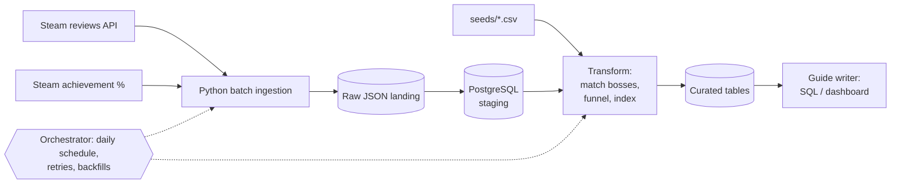

# Elden Ring Boss Rage-Quit Index

> DENG HS26 — End-to-End Batch Data Pipeline · Team XX · Status: **Milestone 1 (Architecture v0.1)**

Which Elden Ring boss makes players give up? This project combines two public Steam sources:

- **What players do:** the global achievement unlock rate for each boss
- **What players say:** Steam reviews that mention a boss

Together they give each boss a *Rage-Quit Index*.

## Use case

| | |
|---|---|
| **Stakeholder** | An Elden Ring guide writer or YouTuber who has to decide which boss guide to make next |
| **Questions** | 1. At which boss do the most players stop progressing? <br> 2. Which bosses show up more often in *negative* reviews? <br> 3. How many hours into the game does that happen? |
| **Data product** | One ranked table, `boss_rage_ranking` (one row per boss), built from two daily intermediate tables (see [docs/use-case.md](docs/use-case.md)) |

## Data sources

| Source | What | Access | Load pattern |
|---|---|---|---|
| Steam reviews API | ~832k user reviews: text, thumbs up/down, playtime at review | public JSON, no key, cursor pagination | historical backfill, then daily incremental |
| Steam global achievement % | unlock rate for 42 achievements, 30 of them boss kills | public JSON, no key | daily snapshot (the API only returns the current value) |

Plus two small hand-made seed tables in `seeds/`, versioned in git:
- `achievement_boss_map.csv`: achievement code → boss
- `boss_aliases.csv`: boss → the names players use in reviews

Details (schema, volume, quality risks): [docs/dataset.md](docs/dataset.md)

## Architecture v0.1



v0.1 runs locally (Docker, PostgreSQL). For the final milestone, the raw landing moves to **Google Cloud Storage** and the curated layer to **BigQuery**, both provisioned with Terraform.

- Full description: [docs/architecture-v0.1.md](docs/architecture-v0.1.md)
- Why these sources: [docs/adr/0001-data-source-selection.md](docs/adr/0001-data-source-selection.md)

## Repository structure

```
.
├── docs/                 # dataset, use case, architecture, plan, ADRs
├── seeds/                # hand-maintained mapping tables
├── ingestion/            # batch ingestion scripts            (Milestone 2)
├── sql/                  # init/ schemas, staging/ and transform/ SQL
├── transform/            # runs seeds + sql/transform/ in one transaction
├── orchestration/        # orchestrator flows                 (Milestone 2)
├── infra/terraform/      # GCS bucket + BigQuery dataset      (Milestone 3)
├── pgadmin/              # pgAdmin server registration
├── Dockerfile            # pipeline image (ingestion + transform)
├── docker-compose.yml    # PostgreSQL + pgAdmin + pipeline on network rage-net
├── data/                 # local data, never committed
└── .env.example          # environment variables (no real secrets)
```

## Milestones

| Milestone | Date | Status |
|---|---|---|
| 1. Pitch, Architecture v0.1 | 01.10.2026 | in progress |
| 2. Midterm: local pipeline (Docker, PostgreSQL, orchestration) | repo 22.10.2026, defence 29.10.2026 | planned |
| 3. Final: cloud pipeline (Terraform, GCS, BigQuery, modeling, DQ) | repo 10.12.2026, defence 17.12.2026 | planned |

Plan and backlog: [docs/project-plan.md](docs/project-plan.md)

## Setup

Requirements: Docker Desktop (or Docker Engine + Compose v2) and Python 3.11+. No API key is needed.

**1. Configure**

```bash
cp .env.example .env        # local dev values; never commit .env
```

**2. Start PostgreSQL + pgAdmin**

```bash
docker compose up -d
docker compose ps           # rage-postgres should be "healthy"
```

On first start, Postgres creates the `raw`, `staging` and `mart` schemas and their tables from [`sql/init/01_schemas.sql`](sql/init/01_schemas.sql). Both containers share the `rage-net` network.

**Verify:**

```bash
docker compose exec postgres psql -U rage -d rage_index -c "\dn" -c "\dt raw.*" -c "\dt staging.*"
```

This should list the schemas `raw`, `staging` and `mart`, plus the tables `raw.achievement_snapshots`, `raw.reviews`, `staging.achievement_snapshot` and `staging.reviews`.

For pgAdmin, open http://localhost:8080. The server "rage-index (local)" is already registered; the password is `POSTGRES_PASSWORD` from `.env`.

**Reset:**
- `docker compose down` stops the containers and keeps the data.
- `docker compose down -v` also deletes the database. The init script only runs on an empty database, so use `-v` after changing it.

If port 5432 or 8080 is already in use on your machine, change `POSTGRES_PORT` or `PGADMIN_PORT` in `.env`.

**3. Python environment**

```bash
python -m venv .venv
source .venv/bin/activate        # Windows: .venv\Scripts\activate
pip install -r requirements.txt
```

**4. Load the achievement snapshots**

```bash
python -m ingestion.sync_snapshots      # snapshots branch -> data/raw/achievements/<date>/
python -m ingestion.load_achievements   # files -> raw.achievement_snapshots -> staging.achievement_snapshot
```

`sync_snapshots` fetches the `snapshots` branch and copies its files into `data/raw`, so you never have to switch branches. `load_achievements` upserts every file. Running it again changes nothing.

**Verify:**

```bash
docker compose exec postgres psql -U rage -d rage_index -c "SELECT snapshot_date, count(*) FROM staging.achievement_snapshot GROUP BY 1 ORDER BY 1"
```

You should see one row per day, each with 42 achievements.

**5. Load the reviews**

```bash
python -m ingestion.load_reviews --max-pages 3          # quick test (~2 s); doesn't move the high-water mark
python -m ingestion.load_reviews --since 2026-10-01     # backfill everything updated since a date
python -m ingestion.load_reviews                        # incremental (the first successful run is a full backfill)
python -m ingestion.load_reviews --resume               # continue the last failed or killed run at its saved cursor
```

How the loader works:
- It pages through the reviews, newest-updated first, and stops once a whole page is older than the high-water mark.
- It saves every page to `data/raw/reviews/<date>/run_<id>/` and upserts it into `raw.reviews`. Then `sql/staging/reviews.sql` updates `staging.reviews`.
- Every run is logged in `raw.ingestion_runs`, along with the cursor of its last finished page.
  - Only a successful run moves the high-water mark.
  - A failed or killed run can be continued with `--resume`.
- **Rate limits:** Steam returns HTTP 429 after roughly 150 fast requests and unblocks after a few minutes. The loader waits 60 s and tries again, up to 10 times, and pauses 1 s between pages.
- **Full backfill:** about 573k English reviews in roughly 5,700 pages. It takes a few hours because of the rate limit, and the raw files take ~600 MB. If your laptop goes to sleep, run `--resume`.
- **Daily incremental run:** 1–2 pages.

If your database was created before the run log changed, add the new table and columns once:
```bash
docker compose exec -T postgres psql -U rage -d rage_index < sql/init/02_ingestion_runs.sql
docker compose exec postgres psql -U rage -d rage_index -c "ALTER TABLE raw.ingestion_runs ADD COLUMN IF NOT EXISTS mark_from bigint, ADD COLUMN IF NOT EXISTS last_cursor text"
```
(A fresh `docker compose down -v && docker compose up -d` does the same.)

**Verify:**

```bash
docker compose exec postgres psql -U rage -d rage_index -c "SELECT run_id, status, rows_loaded, note FROM raw.ingestion_runs ORDER BY run_id DESC LIMIT 5" -c "SELECT count(*), count(*) FILTER (WHERE NOT voted_up) AS negative FROM staging.reviews"
```

The latest run should show `success`, and `raw.reviews` and `staging.reviews` should hold the same number of rows. Running the loader again right away should load 0 reviews.

**6. Transform: find boss mentions**

```bash
python -m transform.run
```

This command:
1. Loads the two seed CSVs into `staging.boss_alias` and `staging.achievement_boss`.
2. Runs every file in [`sql/transform/`](sql/transform/) in order:
   - `01_review_boss_mention.sql` matches each review against the boss aliases on whole words, case-insensitive. It writes one row per review × boss mentioned.
   - `02_boss_mentions_daily.sql` aggregates the matches into `mart.boss_mentions_daily`: one row per review date × boss, with mentions, negative mentions and median playtime in hours.

Everything runs in one transaction, and both steps are full rebuilds, so running it again is safe.

**Verify:**

```bash
docker compose exec postgres psql -U rage -d rage_index -c "SELECT boss_key, sum(mentions) AS mentions, sum(negative_mentions) AS negative FROM mart.boss_mentions_daily GROUP BY 1 ORDER BY 2 DESC LIMIT 10"
```

### Run the pipeline in Docker

Steps 4–6 can also run in a container, so you only need Docker. `docker compose up -d` does **not** start this container; it only runs on demand:

```bash
docker compose build pipeline                                     # once, and after every code change
docker compose run --rm pipeline                                  # daily batch: achievements -> reviews -> transform
docker compose run --rm pipeline python -m ingestion.load_reviews --resume   # or any single step
```

- The image (see [`Dockerfile`](Dockerfile)) holds the code, `sql/` and `seeds/`.
- It joins `rage-net` and reaches the database as host `postgres`. The other settings come from `.env`.
- `./data` is mounted, so raw files land in the same place as when you run on your machine.
- `sync_snapshots` stays on your machine (step 4), because it needs `git` and your GitHub access.

**Verify:**

```bash
docker compose run --rm pipeline python -m transform.run
```

The log should show the seeds (23 aliases, 42 achievements) and a row count for each transform file. The verify queries from steps 4–6 should give the same results as before.

### Daily achievement snapshots (already running)

Steam only provides the *current* achievement percentages, so a missed day can never be recovered. That's why this one job doesn't depend on anyone's laptop being on. It runs every day on GitHub Actions ([`.github/workflows/snapshot-achievements.yml`](.github/workflows/snapshot-achievements.yml)) and commits the result to the **`snapshots`** branch:

```
snapshots branch:  achievements/<YYYY-MM-DD>/achievements.json
```

Run the same script locally (Python 3.11+, standard library only):

```bash
python ingestion/snapshot_achievements.py              # writes data/raw/achievements/<today>/achievements.json
python ingestion/snapshot_achievements.py --data-dir /tmp/raw
```

**Verify:**
- The *Actions* tab shows a green "achievement snapshot" run for each day.
- The `snapshots` branch contains one folder per day.
- Each file holds 42 achievements.
- Running the script again on the same day overwrites that day's file instead of adding a second one.

## Known limitations (v0.1)

- **No history from the source:** Steam only provides today's achievement percentages. History exists only from the day we start snapshotting, and it can't be backfilled.
- **English only:** we only analyse English reviews.
- **Name matching:** boss mentions are found by matching names and nicknames from our seed table. Expect some false positives and misses.
- **Not true churn:** achievement % is a share of *all owners*, including people who never really played. Drop-offs compare bosses to each other; they don't measure how many players quit overall.

## Team

| | Main responsibility |
|---|---|
| Student A | review ingestion (pagination, incremental loads), boss matching, orchestration |
| Student B | achievement snapshots, PostgreSQL + Docker, Terraform + BigQuery |

We build the transformations and the rage index together. We both review each other's work and can explain the whole pipeline.

## Data & terms

The pipeline reads public Steam endpoints only, at a low request rate. Raw data is not redistributed in this repository.
Elden Ring is © FromSoftware / Bandai Namco. This is a non-commercial university project.
