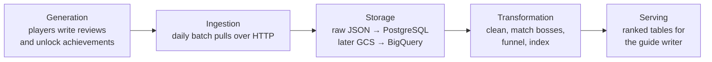

# Architecture v0.1

Status: pitch version (Week 3). This version fixes the lifecycle stages and how each source is loaded. We'll choose and justify the tools for later milestones in v0.2, following the course.

## Lifecycle

## Ingestion

| Source | Strategy | Frequency | Why |
|---|---|---|---|
| Reviews | **One-time historical backfill**, then **incremental**. Fetch the newest reviews first, and stop at the last `timestamp_updated` we already have (the high-water mark) | daily | Reloading 832k reviews every day is wasteful. An edit changes `timestamp_updated`, so edited reviews get picked up again |
| Achievement % | **Full snapshot**, stored with a `snapshot_date` | daily | The API only returns the current value. The only history we get is the snapshots we keep |

**Failure behaviour**

- **Errors and rate limits:** retry with back-off. If that fails, the task fails and the orchestrator retries the run.
- **Idempotent reruns:** raw files are named by source and run date, so re-running a date overwrites the same file.
- **No duplicates:** PostgreSQL loads upsert on the natural keys, `recommendationid` and `(snapshot_date, achievement_code)`.
- **Missed snapshot:** a day without an achievement snapshot can't be recovered. The run logs it as a gap.

## Storage

| Layer | Midterm (local) | Final (cloud) | Content |
|---|---|---|---|
| Raw | JSON files in `data/raw/<source>/<date>/` | GCS bucket | untouched API responses (schema-on-read) |
| Staging | PostgreSQL `staging` schema | BigQuery dataset | typed, deduplicated, English only, Steam IDs dropped |
| Curated | PostgreSQL `mart` schema | BigQuery dataset, partitioned by date | the three output tables |

We keep the raw layer because the matching logic will change. With the raw files we can reprocess everything without downloading 832k reviews again.

## Transformations

1. **Clean reviews.** Keep the latest version of each review. Drop empty and very short ones, and convert the text to lowercase.
2. **Match bosses.** Search the review text for the names in `seeds/boss_aliases.csv`, on whole words only. One review can mention several bosses.
3. **Funnel.** Join the achievement snapshots with `seeds/achievement_boss_map.csv`, then compute each boss's drop-off from the previous main-path boss.
4. **Aggregate.** Build daily mentions per boss, then the rage ranking (see [use-case.md](use-case.md)).

## Open questions

- How many requests can we send to Steam during the full backfill? We'll measure it in week 4.
- Is simple name matching good enough? We'll measure precision on a labelled sample before adding anything smarter.
- Which orchestrator? We decide in week 5; the course uses Kestra.

## Who does what

| Area | Owner |
|---|---|
| Review ingestion, boss matching, orchestration | Student A |
| Achievement snapshots, PostgreSQL + Docker, Terraform + BigQuery | Student B |
| Transformations, rage index, docs | both |

Each of us reviews the other's work.
