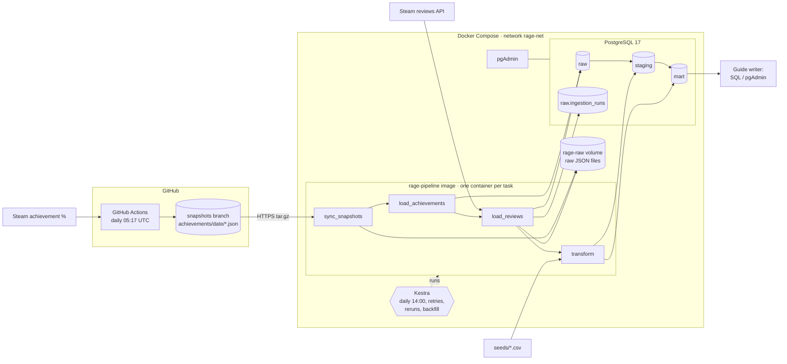

# Architecture v0.2

Status: midterm version (22.10.2026). This is the pipeline as it runs locally today. [v0.1](architecture-v0.1.md) fixed the lifecycle stages; v0.2 chooses the tools and documents what we learned while building. The [changes since v0.1](#changes-since-v01) are listed at the end.

## Overview

## Components and why we chose them

| Component | Tool | Why |
|---|---|---|
| Achievement snapshot | Python script (standard library) on **GitHub Actions**, committing to the `snapshots` branch | The history can't be backfilled, so this one job must not depend on a laptop being on. Actions is free, needs no server, and every snapshot is versioned in git |
| Ingestion | Python modules, one per source (`ingestion/`) | Small and plain, so we can both explain every line. `psycopg` writes to Postgres |
| Raw landing | JSON files, one per API page (`data/raw/<source>/<date>/`, or the `rage-raw` volume in Kestra) and `jsonb` in the `raw` schema | Lets us rebuild staging without calling Steam again (a full review load takes 3 h). In the final milestone, these files move to GCS |
| Storage | **PostgreSQL 17** with the schemas `raw` → `staging` → `mart` | Required for the midterm. The SQL carries over to BigQuery with few changes |
| Transformation | SQL files in `sql/transform/`, run by `transform/run.py` in one transaction | The logic sits next to the data, and one transaction means a failed run leaves the old tables intact |
| Orchestration | **Kestra 2.0** in Docker Compose | It's the course tool. Flows are YAML in git, it has a built-in schedule, retries, restarts and backfills, and its own database on the same Postgres server |
| Runtime | One **pipeline image** (`Dockerfile`). Kestra starts one container per task on `rage-net` | The same image runs from Kestra, `docker compose run` and later the cloud. Peer reviewers need only Docker |

## Tables and grain

| Table | One row per … | Filled by | Load pattern |
|---|---|---|---|
| `raw.achievement_snapshots` | snapshot day (whole API response) | `load_achievements` | upsert on `snapshot_date` |
| `raw.reviews` | review, latest version | `load_reviews` | incremental upsert on `recommendationid`; high-water mark `timestamp_updated` |
| `raw.ingestion_runs` | loader run | `load_reviews` | append, then updated at the end of the run |
| `staging.achievement_snapshot` | snapshot day × achievement | `sql/staging/achievement_snapshot.sql` | upsert |
| `staging.reviews` | English review (typed; Steam IDs dropped) | `sql/staging/reviews.sql` | upsert of the rows loaded since the last successful run |
| `staging.boss_alias` | boss × alias (seed) | `transform.run` | full reload |
| `staging.achievement_boss` | achievement (seed) | `transform.run` | full reload |
| `staging.review_boss_mention` | review × boss mentioned | `sql/transform/01_review_boss_mention.sql` | full rebuild (15 s on 573k reviews) |
| `mart.boss_mentions_daily` | review date × boss | `sql/transform/02_boss_mentions_daily.sql` | full rebuild |

Planned for the final milestone: `mart.boss_funnel_daily` (snapshot date × boss) and the data product `mart.boss_rage_ranking` (one row per boss). See [use-case.md](use-case.md).

## The transformation: boss matching

- **What it does:** it turns free review text into a countable fact, namely which boss a review talks about. Questions 2 and 3 of the use case (complaints and playtime per boss) need exactly that.
- **How:** case-insensitive regex on whole words, `review ~* '\m' || alias || '\M'`, against 23 aliases from `seeds/boss_aliases.csv`. Several aliases of the same boss in one review count once.
- **Result on all data:** 17,735 mentions in 13,455 reviews (2.3 %).
- **First finding:** Malenia is mentioned by far the most, but has the lowest share of negative reviews (6.5 %). So the ranking must use the *share* of negative reviews, not mention counts.
- **Quality:** we are checking precision on a hand-labelled sample of 63 matches. Known false positive: "astel" also matches the spell *Meteorite of Astel*.

## Failure handling, reruns and backfills

| Situation | What happens |
|---|---|
| Steam rate limit (HTTP 429 after ~160 fast requests) | The loader waits 60 s and tries again, up to 10 times, and pauses 1 s between pages |
| Other HTTP or network errors | Back-off after 2, 4 and 8 s, then the task fails |
| Task fails | Kestra retries it up to 3 times, 2 minutes apart. After that, the execution is `FAILED` and can be restarted from the failed task |
| Run crashes or the laptop sleeps mid-backfill | The run stays `failed`/`running` in `raw.ingestion_runs` with the cursor of its last page. `load_reviews --resume` continues from there |
| Rerun of any step | Safe. Loads are upserts on natural keys, transforms are full rebuilds in one transaction, raw files are overwritten |
| Backfill reviews | Kestra input `since` (or `--since`): everything updated since that date is loaded again and upserted |
| Missed schedule days | Kestra trigger backfill. Each run is incremental and catches up |
| Missed achievement snapshot | Lost for good, because Steam has no history. That's why the snapshot runs on GitHub Actions |

Only a successful run moves the high-water mark (it becomes the newest `timestamp_updated` in the table). A crashed or test run never skips reviews.

## Changes since v0.1

| v0.1 | v0.2 | Why |
|---|---|---|
| One orchestrator runs all ingestion | The achievement snapshot runs on **GitHub Actions**; Kestra runs everything else | A snapshot that is missed is lost for good. A laptop-based orchestrator can't guarantee a run every day |
| "Retry with back-off" | A separate **rate-limit handling** (60 s waits) and **resumable** backfills with a cursor in the run log | The first full backfill failed with HTTP 429 at page 150. The full backfill takes 3 h 14 min |
| Raw files named by source and date | Raw files per run and page (`<date>/run_<id>/page_NNNNN.json`), plus `jsonb` in a `raw` schema | A backfill spans thousands of pages, and the raw schema lets SQL rebuild staging |
| Orchestrator open | **Kestra**, one container per task with the pipeline image | Course tool. The image keeps the steps identical on every machine |
| "Clean reviews" as its own step | The cleaning is part of staging (types, English only, Steam IDs dropped) | Simpler: there is one place for it |
| Language filter in the API is enough | Staging also filters `language = 'english'` | Steam returned 3 non-English reviews despite `language=english` |
| Three output tables | **One** data product (`boss_rage_ranking`) plus two intermediate tables | Feedback from the pitch |

## Open (towards the final)

- Funnel and ranking tables, and the final `rage_index` definition.
- Matching precision: finish the labelled sample and fix or drop weak aliases.
- Move to the cloud: raw files to GCS without local storage first, curated tables in BigQuery (with partitioning and clustering), Terraform.
- Data-quality checks: row counts, duplicates, freshness of the latest snapshot.
- Ambiguous aliases: "radahn", "mohg" and "godfrey" also match the DLC versions or other bosses with the same name.
